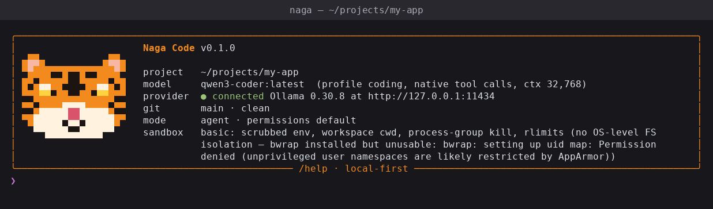
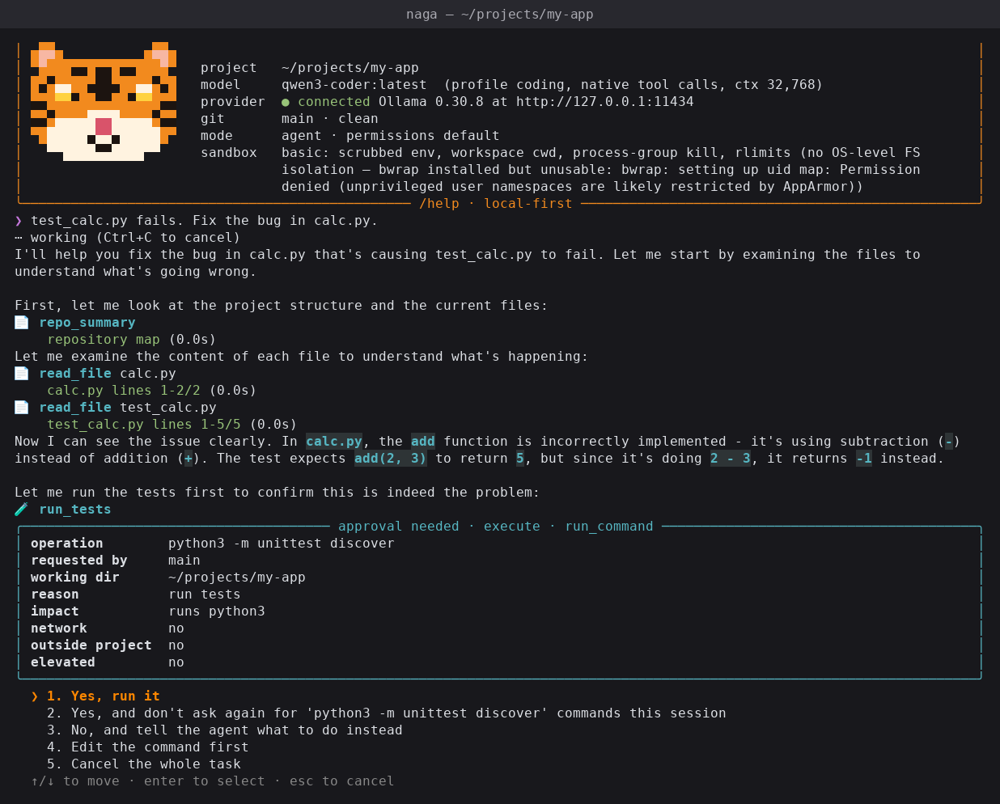
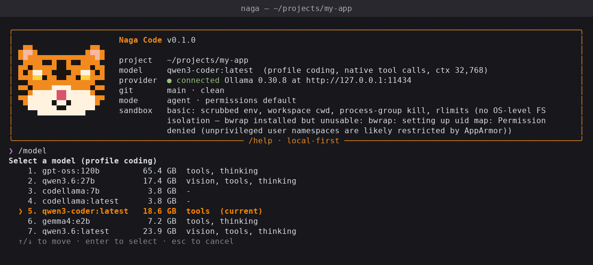
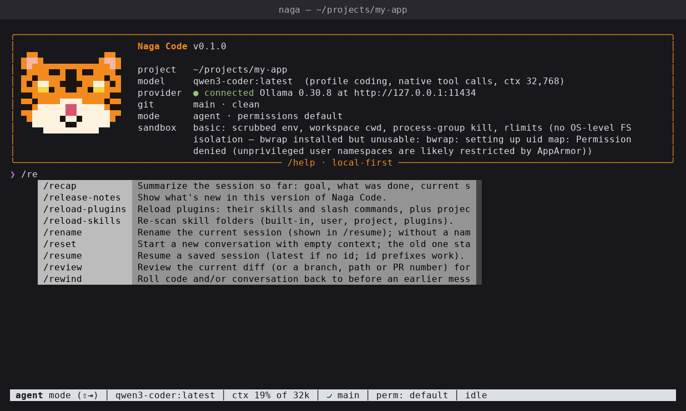
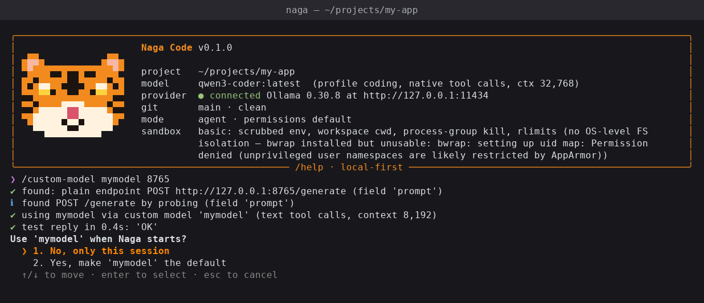

# Naga Code 🐯

A local-first AI coding agent for your terminal. Naga reads your repository, plans changes, edits files, runs
commands and tests, reviews code, and works through tasks with you, using **open-weight models running on your
own machine**. It needs no API key, account or cloud model, and prompts never leave `localhost` unless you set
it up that way.



| Every edit and command asks first, with an arrow-key menu | Switch models with `/model` |
|---|---|
|  |  |

| Commands complete as you type | Plug in your own model server with `/custom-model` |
|---|---|
|  |  |

These screenshots come from real sessions with `qwen3-coder` on Ollama. A script ran `naga` in a hidden
terminal and drew its output, colours included, into each image.

**Contents:** [Features](#features) · [Install](#install) · [Quick start](#quick-start) ·
[Models](#models) · [Custom models](#custom-models-your-own-model-server) · [Commands](#commands) ·
[Safety](#safety) · [Skills, subagents, plugins, MCP, hooks](#extending-naga) ·
[Sessions & memory](#sessions-memory-and-undo) · [Configuration](#configuration) ·
[Project layout](#project-layout) · [Testing](#testing) · [Troubleshooting](#troubleshooting) ·
[Limitations](#known-limitations)

## Features

- **Works with local models:** Ollama, llama.cpp, vLLM, LM Studio, any OpenAI-compatible server, or **your own
  Python model server on a port** (`/custom-model`).
- **Real agent loop:** reads and searches code, edits with diffs, runs commands and tests, and checks its work.
  The end-of-turn summary is built from what actually ran, not from what the model claims.
- **You stay in control:** every edit and command asks first, through an arrow-key menu. You can allow
  something for the session, deny it with a reason, or edit the command. Dangerous commands always ask, and
  catastrophic ones are blocked.
- **Undo anything:** `/undo` reverts the last edit, and `/rewind` rolls code and conversation back to any
  earlier message.
- **About 100 slash commands:** planning, reviews, background jobs, loops, goals, side questions, model
  switching, plugins and more. See [COMMANDS.md](COMMANDS.md).
- **Ways to extend it:** skills, subagents, plugins, MCP servers, lifecycle hooks and project commands.
- **Private by design:** no telemetry. The audit log, sessions and memory stay on your machine, with secrets
  redacted.

## Install

Requirements: Linux (developed on Ubuntu 24.04), Python 3.12+, [uv](https://docs.astral.sh/uv/), git, and a
local model server ([Ollama](https://ollama.com) is the default). `ripgrep` is recommended.

```bash
git clone https://github.com/sureshkalla554/naga-code.git
cd naga-code
scripts/install.sh                 # installs the `naga` command into ~/.local/bin (no sudo)
naga doctor                        # checks GPU, Ollama, models and sandbox
```

The install is *editable*: changes to the source apply the next time you start `naga`, so don't move or delete
the cloned folder. For development, `uv sync` creates `.venv`, and `uv run naga` runs from source.

Uninstall: `scripts/uninstall.sh` keeps your settings and sessions. `scripts/uninstall.sh --purge` also deletes
them, after asking.

## Quick start

```bash
cd ~/projects/my-app
naga                                   # start a session in this project
naga --resume                          # continue the last session here
naga --mode plan                       # start in plan mode (investigate, propose, then approve)
naga -p "explain the auth flow" --mode ask              # one answer, no interaction
naga -p "fix the failing test" --allow-edits --allow-commands "uv run pytest"
```

Inside a session, type what you want in plain language, or use a command:

```text
/init                         write NAGA.md: project overview, build/test commands, conventions
/plan add login to the API    investigate read-only, show a plan, implement after you approve
/model                        pick a model with the arrow keys
/code-review --fix            review the current diff and apply the fixes
/btw what does utils.py do?   side question that isn't added to the conversation
/rewind                       go back to an earlier point (code and/or conversation)
```

**Keys:** Enter sends · Alt+Enter or Ctrl+J adds a new line · Shift+Tab cycles mode (ask → plan → agent) ·
Ctrl+C cancels the running task · Ctrl+D exits · `!command` runs a shell command yourself.

**Modes:**
- **ask:** answers and investigates using read-only tools.
- **plan:** investigates, then records a plan for you to approve.
- **agent:** does the work, then validates it.

## Models

| provider kind | for | notes |
|---|---|---|
| `ollama` | Ollama | default; streaming, native tool calls, thinking, context length from the model |
| `openai_compatible` | vLLM, LM Studio, LocalAI, any `/v1/chat/completions` server | streamed tool calls, reasoning output |
| `llama_cpp` | `llama-server` | start it with `--jinja` for tool calls |
| `simple_http` | your own `POST /generate`-style endpoint | added by `/custom-model`; uses text tool calls |

**Profiles** are named roles (`coding`, `fast`, `reasoning`, `vision`, `subagent`, plus your custom models),
each mapping to a provider, model and settings. Switch with `/model` (arrow-key menu), `/fast`, or
`naga --profile NAME`. Models whose server reports no tool support use a strict text protocol
(`<tool_call>{json}</tool_call>`), and Qwen's XML-style calls are understood too. Naga never downloads models;
pull them yourself (e.g. `ollama pull qwen3-coder`).

Measured on an RTX 3090 (24 GB) with Ollama 0.30.8 and `scripts/benchmark.sh`. Each task is checked by re-running
the tests independently.

| model | role | result | notes |
|---|---|---|---|
| `qwen3-coder:latest` (30B MoE) | coding / subagent | **15/15** (5 runs × 3 tasks) | fast and reliable with tools; ~20–55 s per task |
| `qwen3.6:27b` | reasoning / vision | 3/3 | thinking + vision; slower |
| `qwen3.6:latest` (36B MoE) | coding (current default here) | 1 smoke test passed | ~21.7 GB VRAM; not benchmarked |
| `gemma4:e2b` | fast | 2/3 | quick, but gave up on one task |
| `codellama:7b` | — | 0/3 | no tool support |

## Custom models (your own model server)

If you run a model with your own Python code, point Naga at it by **port** or by **URL**:

```text
/custom-model mymodel 8000                                   # server on this machine, port 8000
/custom-model mymodel 8000 /api/infer                        # tell it the endpoint path
/custom-model gpu 192.168.1.20:8000                          # another machine on your network
/custom-model gpu http://gpu-box:8000/generate               # the full endpoint URL
/custom-model cloud https://llm.example.com/v1 --api-key-env MY_LLM_KEY
/custom-model team https://example.com/proxy/mymodel         # an API behind a path prefix
/custom-model mymodel 8000 --model my-llm --ctx 16k
/custom-model list | use mymodel | remove mymodel
```

URL endings tell Naga what to expect:
- `/v1`, `/v1/chat/completions` or `/v1/models`: an OpenAI-compatible server.
- `/api/generate`, `/api/chat` or `/api/tags`: an Ollama server.
- Any other path is tried first as a prefix in front of an API, then as the endpoint itself.

**API keys:** if the server needs a key, put it in an environment variable and pass the variable's *name* with
`--api-key-env`. The key is sent as `Authorization: Bearer …` and is never written to the config file. Export
the variable before starting `naga`.

**Remote servers:** before connecting to a server that isn't on this machine, Naga asks you to confirm, because
your prompts, including code and command output, will be sent there.

Naga works out what the server speaks:
1. **OpenAI-compatible** (`GET /v1/models`, or `/v1/chat/completions` listed in `/openapi.json`). It also tests
   whether the server accepts native tool calls.
2. **Ollama-style** (`GET /api/tags`).
3. **A plain endpoint** such as `POST /generate {"prompt": "..."}`. Naga finds it from the server's
   `/openapi.json` (FastAPI) or by probing common paths (`/generate`, `/chat`, `/predict`, …), and works out the
   request field (`prompt`, `message`, `messages`, `text`, `input`, …). The reply text is taken from `response`,
   `text`, `output`, `generated_text`, `choices[0].message.content`, or the raw body.

It then sends a test message, switches the session to that model, and asks whether to make it the default.
Custom models are saved in `~/.config/naga/config.toml` and also appear in the `/model` menu.

The smallest server that works:

```python
from fastapi import FastAPI
from pydantic import BaseModel

app = FastAPI()

class Req(BaseModel):
    prompt: str

@app.post("/generate")
def generate(req: Req):
    return {"response": my_model(req.prompt)}   # your generation code
```

## Commands

The full list with usage, descriptions and aliases is in **[COMMANDS.md](COMMANDS.md)**. Some highlights:

| area | commands |
|---|---|
| everyday | `/help` `/model` `/custom-model` `/mode` `/status` `/undo` `/rewind` `/btw` `/copy` `/clear` `/exit` |
| planning & review | `/init` `/plan` `/ultraplan` `/goal` `/code-review` `/ultrareview` `/security-review` `/simplify` `/verify` `/batch` |
| background work | `/background` `/fork` `/list-agents` `/stop` `/subtask` `/loop` `/schedule` |
| model & context | `/fast` `/effort` `/advisor` `/output-style` `/context` `/compact` `/cost` `/usage` |
| look & feel | `/theme` `/color` `/vim` `/focus` `/statusline` |

The command names follow popular coding agents. Commands that need a cloud account (`/login`, `/teleport`,
`/remote-control`, …) explain why they're unavailable instead of failing silently.

## Safety

Every tool call follows one path: **schema validation → risk assessment → hooks → permission check → run
with a timeout → audit log**.

| level | examples | default |
|---|---|---|
| read | read/search files, `git status`, `ls`, `rg` | automatic |
| write | edit files in the project | ask (automatic in `accept-edits` mode) |
| execute | tests, builds, other commands, MCP tools, web requests | ask |
| dangerous | `sudo`, `git reset --hard`, force push, `curl \| sh`, credential files | always ask; never allowed for a whole session |
| blocked | `rm -rf /`, `mkfs`, `dd` to disks, fork bombs | refused |

- **Confined to the project:** paths are resolved, symlinks included, and must stay inside the project, and
  `.git/` can't be written directly. A folder added with `/add-dir` asks before *every* edit.
- **No silent overwrites:** the agent must read a file before editing it, and an edit is refused if the file
  changed on disk since then (for example, because you edited it).
- **Commands** run with no stdin, in their own process group, so Ctrl+C or a timeout kills the whole tree.
  Output is bounded and the environment is scrubbed of secret-looking variables.
- **Sandbox:** bubblewrap isolation is used where it's allowed. On stock Ubuntu 24.04, AppArmor blocks it, so
  Naga falls back to process-level isolation and says so in `/doctor`.
- **Untrusted inputs:** repository files can't loosen permissions or run hooks or MCP servers until you trust
  them (`/hooks trust`, `/mcp trust NAME`).
- **Background jobs, schedules and `-p` runs** have no approver, so anything needing approval is denied unless
  you pre-allow it (`--allow-edits`, `--allow-commands PREFIX`).

## Extending Naga

- **Skills** are folders with a `SKILL.md` (YAML frontmatter plus instructions). Naga ships 16 built-in skills
  (code-review, bug-fix, refactoring, security-review, …). You can add your own in `~/.config/naga/skills/` or
  `.naga/skills/`, or generate one with `/run-skill-generator`. Check them with `/skill-doctor`.
- **Subagents** run bounded tasks with their own context and a permission ceiling: explorer, architect,
  code-reviewer, security-reviewer, test-engineer, performance-analyst, documentation-writer and implementer.
  Use them through `/delegate`, `/subtask`, or the agent's `delegate` tool.
- **Plugins** are folders in `~/.config/naga/plugins/<name>/` with `skills/` and `commands/`. Manage them with
  `/plugin install PATH | enable | disable | remove`, and create one with `/plugin-authoring`.
- **Project commands:** each `.naga/commands/<name>.md` file becomes `/<name>`, and `$ARGUMENTS` is replaced by
  what you type after the command.
- **MCP servers** go in `~/.config/naga/mcp.json` or `.naga/mcp.json`, with stdio or Streamable HTTP transport.
  Tools appear as `mcp__SERVER__TOOL`. `/import` can bring servers over from Gemini CLI and Cursor configs.
- **Hooks** are shell commands that run on events (`after_file_modification`, `before_tool`, …). A `before_*`
  hook can veto an action by exiting with status 2.

## Sessions, memory and undo

- **Sessions** are saved after every turn in `~/.local/share/naga/sessions/`. Use `/resume`, `/branch`,
  `/rename` and `/export`.
- **Context** is tracked against the model's real token counts. Old tool output is shortened, and the
  conversation is summarised before it overflows (`/compact`, `/autocompact`, `/context`).
- **Project instructions** come from `NAGA.md` (also `AGENTS.md` and `CLAUDE.md`), `.naga/NAGA.md` and
  `NAGA.local.md`.
- **Memory:** only entries you approve are kept, via `/memory` or the agent's `remember` tool, which always asks.
- **Undo:** `/undo` reverts the agent's last edit, but only if you haven't changed the file since. Otherwise it
  shows a reverse patch instead. `/rewind` goes back several steps, and `/checkpoint` saves patches of
  everything the agent changed.

## Configuration

Settings layer as follows: `~/.config/naga/config.toml` (see `examples/config.example.toml`), then the
project's `.naga/config.toml` (security-related keys are ignored there), then command-line flags. View or
change them with:
- `/config` to see the merged settings
- `/config key=value` to set a value
- `/update-config` to describe the change in plain words

`NAGA_HOME=/dir` moves all config and data elsewhere, which is useful for testing.

## Project layout

```
src/naga_code/
  cli.py                 command line (`naga`, `naga -p`, `naga doctor`, ...)
  app.py                 NagaApp: wires config, providers, tools, agent, sessions together
  commands.py            core slash commands and the command registry
  commands_extra.py      the rest of the slash commands (rewind, btw, background, custom-model, ...)
  custom_models.py       detects and saves your own model servers
  background.py          background jobs (/background, /fork)
  plugins.py             plugin discovery and install
  agent/                 agent loop, context management, prompts, planner, repo map
  providers/             ollama, openai_compatible, llama_cpp, simple_http, text tool protocol
  tools/                 filesystem, patching, terminal, search, git, testing, web
  security/              command risk, permissions, sandbox, redaction, audit log
  skills/ subagents/ mcp/ memory/
  ui/                    terminal app, arrow-key menus, approval prompt, renderer, tiger logo, themes
tests/                   unit, security and integration tests
scripts/                 install.sh, uninstall.sh, benchmark.sh, gen_commands.py
COMMANDS.md              every slash command (generated: uv run python scripts/gen_commands.py > COMMANDS.md)
```

## Testing

```bash
uv run pytest -q                 # 166 tests with a fake model and local test servers; no GPU or network
uv run pytest -m integration     # 2 tests against your real Ollama model
uv run ruff check src tests
scripts/benchmark.sh --runs 3    # end-to-end coding tasks, results re-checked independently
```

## Troubleshooting

| problem | fix |
|---|---|
| `provider unavailable` | start Ollama (`ollama serve` / `systemctl status ollama`), then `naga doctor` |
| `model 'x' is not available` | `naga models`, then `ollama pull x`, or pick another with `/model` |
| slow, or CUDA out of memory | use a smaller model, lower `num_ctx`, unload others (`ollama ps`, `ollama stop NAME`) |
| `/custom-model` can't find the API | pass the endpoint: `/custom-model NAME PORT /your-endpoint`, or the full URL |
| `/custom-model` says the server requires authentication | `export MY_KEY=...`, then add `--api-key-env MY_KEY` |
| custom model answers but never uses tools | small models struggle with the text tool protocol; try a stronger model |
| everything is denied in `-p` mode | add `--allow-edits` / `--allow-commands PREFIX`, or run interactively |
| `bwrap … Permission denied` | expected on Ubuntu 24.04; Naga uses the basic sandbox instead |
| `/copy` doesn't reach the clipboard | install `xclip` (X11) or `wl-clipboard` (Wayland) |

## Known limitations

- There's no in-process Hugging Face `transformers` backend. Serve the model behind a port and use
  `/custom-model`.
- Code search is ripgrep plus pattern matching, with no tree-sitter or language server.
- Subagents that write files share one working tree (one at a time), not separate git worktrees.
- `/rewind` restores files only for changes made since Naga started.
- Commands that need a cloud account (login, remote control, teleport, …) aren't available.
- Image input isn't exposed in the terminal UI yet, and web search isn't included.
- Local models vary. Check the turn summary, which reports what actually happened.
